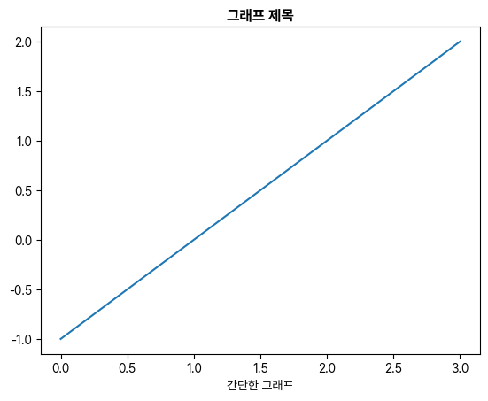

# koreanize-matplotlib-pretendard
matplotlib를 한국어 표시에 대응시킵니다. [koreanize-matplotlib](https://github.com/ychoi-kr/koreanize-matplotlib)을 기반으로, 기본 폰트를 나눔고딕 대신 [Pretendard](https://github.com/orioncactus/pretendard)로 바꾼 버전입니다.

## 사용법
matplotlib를 import한 후 koreanize_matplotlib를 import합니다.

```python
import matplotlib.pyplot as plt
import koreanize_matplotlib

plt.plot([-1, 0, 1, 2])
plt.title('그래프 제목', fontweight="bold")
plt.xlabel('간단한 그래프')
plt.show()
```



## 실행 환경
- Python 3.13+
- matplotlib

## 설치
GitHub 저장소에서 직접 설치합니다.

```sh
pip install git+https://github.com/lunaiz-corp/koreanize-matplotlib-pretendard.git
```

특정 브랜치나 태그를 지정하려면 주소 뒤에 `@이름`을 붙입니다.

```sh
pip install git+https://github.com/lunaiz-corp/koreanize-matplotlib-pretendard.git@main
```

또는 저장소를 내려받아 설치합니다.

```sh
git clone https://github.com/lunaiz-corp/koreanize-matplotlib-pretendard.git
cd koreanize-matplotlib-pretendard
pip install .
```

## 개발 환경 설정

```sh
uv sync
```

## 테스트

```sh
uv run pytest
```

## 사용한 폰트
[Pretendard](https://github.com/orioncactus/pretendard) ([SIL Open Font License 1.1](https://github.com/orioncactus/pretendard/blob/main/LICENSE))

## 원본 프로젝트
이 프로젝트는 [ychoi-kr/koreanize-matplotlib](https://github.com/ychoi-kr/koreanize-matplotlib)을 포크하여 만들었습니다.